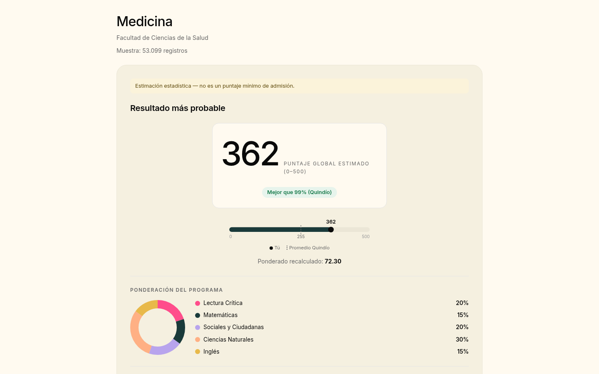
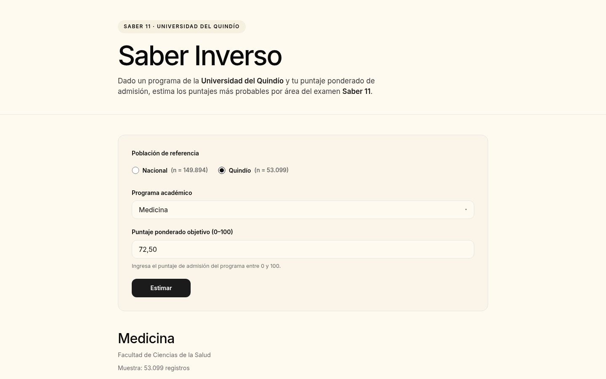
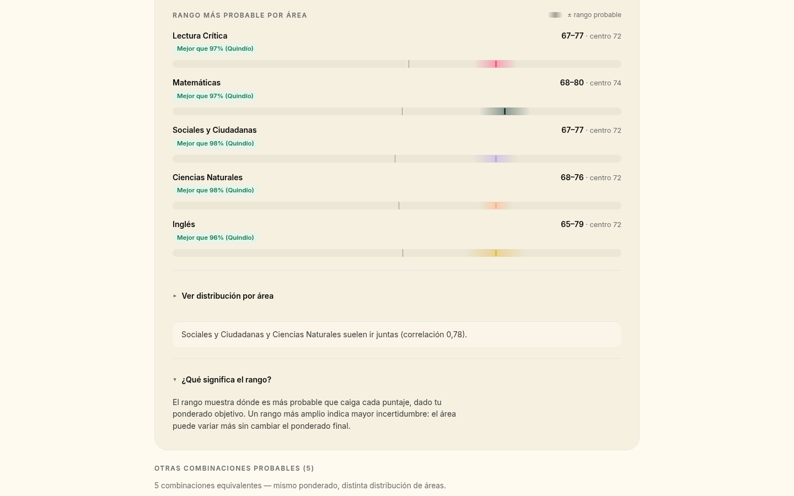
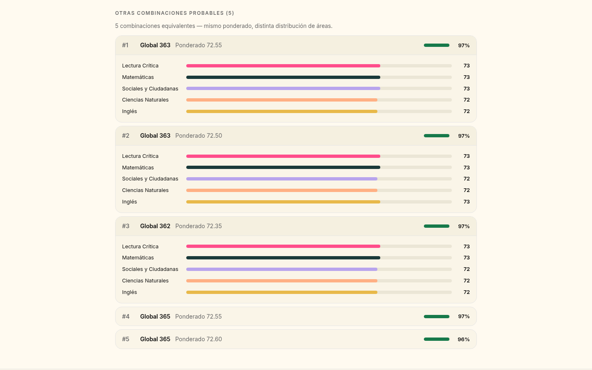
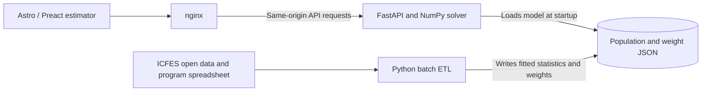

<!-- markdownlint-disable-next-line MD041 -->
<div align="center">

<h1>Saber Inverso</h1>

<p><strong>Estimate Saber 11 subject scores from a Universidad del Quindío admission-score target.</strong></p>

<p>
<a href="https://github.com/diegnghtmr/saber-inverso/actions/workflows/ci.yml"></a>


<a href="LICENSE"></a>
</p>

<p>
<a href="https://diegnghtmr.me/en/work/saber-inverso/"><strong>Case study</strong></a> &bull;
<a href="#quick-start"><strong>Quick start</strong></a> &bull;
<a href="#architecture"><strong>Architecture</strong></a>
</p>

</div>

<p align="center"></p>

One weighted admission score can come from many different sets of Saber 11 subject scores. Saber Inverso uses historical ICFES data to rank plausible combinations and shows how much each estimate can vary. It helps applicants explore targets; it does not recover an individual's scores, predict admission, or represent the ICFES or Universidad del Quindío.

## Features

- **Program-specific estimates.** Select a program, a weighted target, and either the national or Quindío reference population.
- **Two scoring scales.** See the recalculated UQ weighted score out of 100 separately from the estimated ICFES global score out of 500.
- **Uncertainty by subject.** View ranges derived from the conditional spread rather than treating one combination as the only answer.
- **Ranked alternatives.** Compare integer score combinations near the target; relative likelihood is not a chance of admission.
- **Bundled model.** Make estimates from checked-in population statistics and program weights, without a live ICFES connection.

## Preview



Enter the weighted target for a program and pick the comparison population.



Two subjects can have the same center and different uncertainty.



Different combinations can fit almost the same target.

## Quick start

Use Docker with Compose. The default services use the bundled JSON; the first build may need network access to obtain images and dependencies.

```sh
git clone https://github.com/diegnghtmr/saber-inverso.git
cd saber-inverso
docker compose up --build
```

Open `http://localhost:8080`. The web container proxies `/api` to FastAPI on the same origin. The optional Compose settings are listed in [env.example](env.example); you can supply them in your environment or copy the template to `.env` for local overrides.

| Variable | Purpose | Default |
| --- | --- | --- |
| `WEB_PORT` | Compose host port for the web UI. | `8080` |
| `ICFES_DEFAULT_POPULATION` | Default population sent by the API. | `quindio` |
| `ICFES_DATA_DIR` | Directory holding `model_stats.json` and `program_weights.json`. | `/data` in Compose; repository `data/` natively |
| `ICFES_DEFAULT_ALTERNATIVES` | Default alternative count for native API requests. | `6` |
| `ICFES_CORS_ORIGINS` | Comma-separated browser origins for cross-origin development. | `http://localhost:4321,http://localhost:3000` |
| `PUBLIC_API_BASE` | Browser API origin for split native development. | Empty (same origin) |
| `ICFES_NATIONAL_CAP` | ETL national sample cap per period. | `25000` |
| `ICFES_XLSX_PATH` | ETL input workbook with official program weights. | `source/` workbook in Compose; sibling workbook outside the repository in native mode |

For native development, use Python **3.12** and Node.js **22** as in CI. In separate terminals from the repository root:

```sh
cd services/api
python -m pip install -r requirements-dev.txt
uvicorn app.main:app --reload --port 8000
```

```sh
cd web
npm ci
PUBLIC_API_BASE=http://localhost:8000 npm run dev
```

Open `http://localhost:4321` for the UI and `http://localhost:8000/docs` for the API browser. `GET /health` returns service status and dataset metadata; `GET /api/areas`, `/api/populations`, and `/api/programs` list the inputs. `POST /api/estimate` returns the estimate and alternatives; `POST /api/forward` calculates both score types from five subject scores.

```sh
curl -fsS http://localhost:8000/api/estimate -H 'Content-Type: application/json' \
  -d '{"programa":"Medicina","puntaje":70,"poblacion":"quindio","alternativas":6}'
```

## Architecture

Astro serves a Preact estimator; in Compose, nginx forwards same-origin API requests to FastAPI. The NumPy solver conditions a five-dimensional normal score model on a program's weighted total. It uses the conditional covariance for uncertainty and Mahalanobis distance to rank integer alternatives near the target. Rounding can move the recalculated total off the target.



The UQ score is `Σ wᵢ · areaᵢ` with program-specific weights that sum to 1. The ICFES global formula is `round(5 × (3·LC + 3·MAT + 3·SOC + 3·CN + ING) / 13)`. The model cannot invert programs missing from the weights table or applicants using the English-exemption formula.

## Tech stack

| Layer | Technology |
| --- | --- |
| Browser | Astro 5, Preact 10, TypeScript |
| HTTP and estimator | FastAPI, Uvicorn, NumPy, SciPy |
| Data preparation | Python, pandas, openpyxl, Socrata |
| Runtime and quality | nginx, Docker Compose, pytest |

## Testing

```sh
(cd services/api && python -m pytest)
(cd web && npm ci && npm run build)
docker compose config -q
```

CI tests the solver and HTTP contract with bundled data, builds the web app, and validates Compose configuration. The optional `services/etl/validate_poc.py` evaluates forward-to-inverse round trips with the source data; model estimates are not individual exam results.

## Project structure

```text
data/          Committed model and weights; raw downloads are ignored
services/api/  FastAPI, solver, data repositories, and tests
services/etl/  Data download, statistics, extraction, and validation
web/           Astro frontend and nginx proxy
```

## Documentation

See the [model and data preparation notes](docs/model-and-data.md) for formulas, source-period coverage, validation, and the optional artifact refresh. The application does not need the source workbook at runtime.

## License

Code: [MIT](LICENSE). The original [ICFES Saber 11 open dataset](https://www.datos.gov.co/Educaci-n/Resultados-nicos-Saber-11/kgxf-xxbe) is attributed to ICFES under CC BY-SA 4.0; that license applies to derivatives of the dataset.
